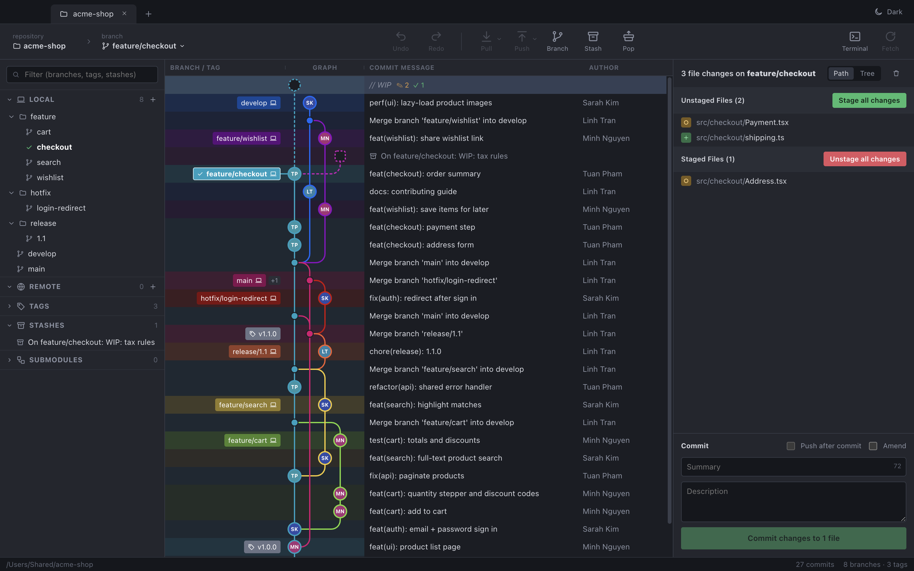
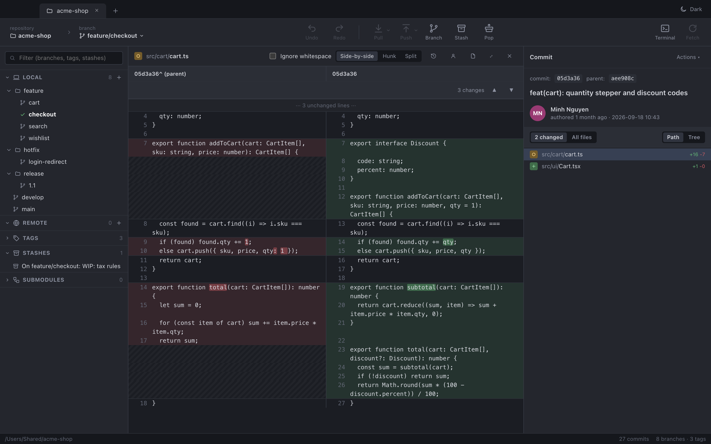
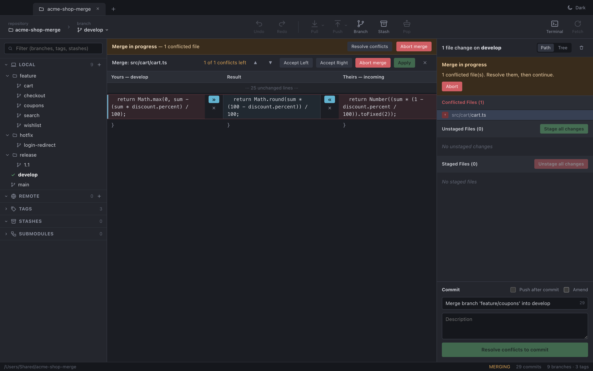
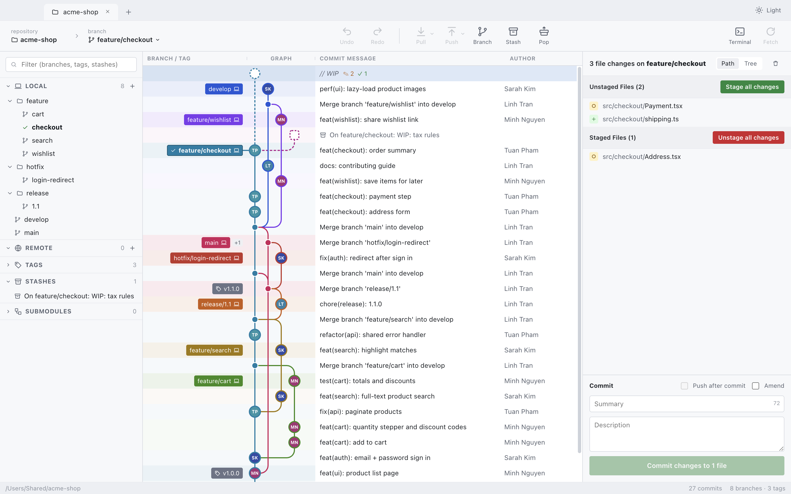
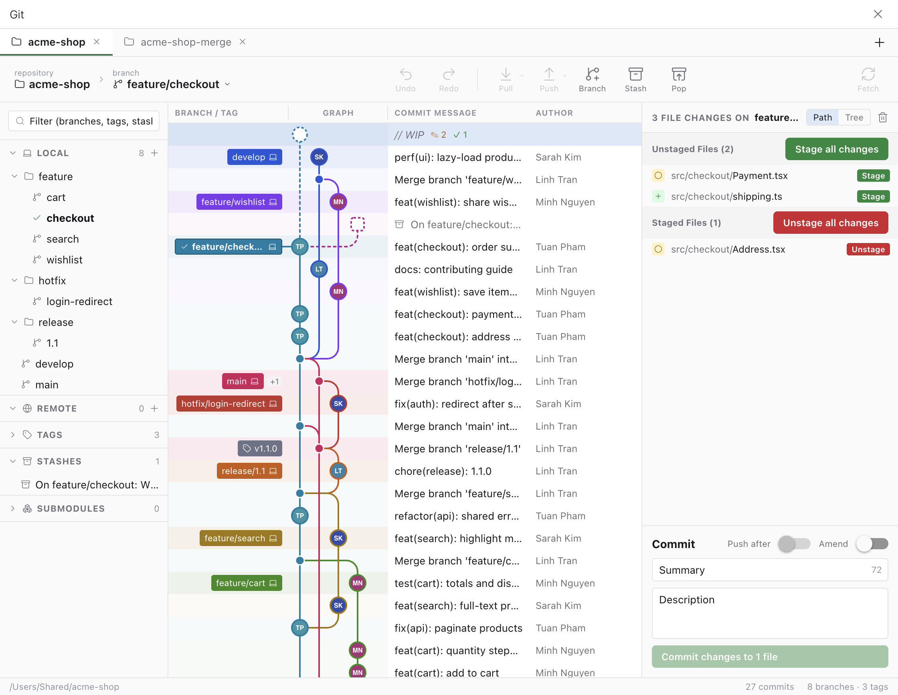
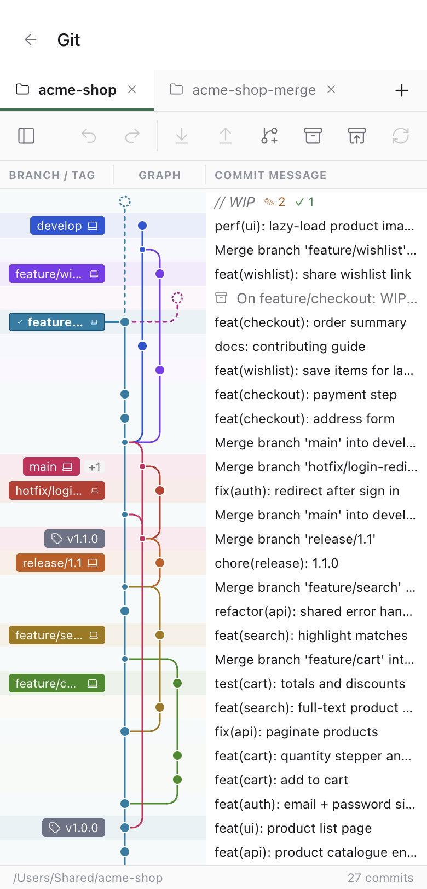

<p align="center">
  
</p>

<h1 align="center">GitHistory</h1>

<p align="center">
  A free, open-source Git client with a beautiful commit graph, side-by-side diffs and a three-way merge tool.<br>
  Desktop app for <b>macOS</b>, <b>Windows</b> and <b>Ubuntu</b> — and a plugin for <a href="https://paseo.sh">Paseo</a> that works on desktop, web and phones.
</p>

<p align="center">
  <a href="https://github.com/ltd412/GitHistory/releases/latest"><b>Download</b></a> ·
  <a href="#install">Install</a> ·
  <a href="#paseo-plugin">Paseo plugin</a> ·
  <a href="#build-from-source">Build from source</a> ·
  <a href="README.vi.md">Tiếng Việt</a>
</p>



## Why GitHistory

- **See your history.** A GitKraken-style graph: every branch in its own coloured lane, merges that curve
  back into their parent, branch and tag labels attached to their commits, author avatars, stashes and your
  uncommitted work drawn right in the graph.
- **Do everything from the graph.** Right-click any commit or label for one consistent menu: checkout,
  merge (with a choice of strategy), rebase (with a warning when it would rewrite pushed commits), cherry-pick,
  revert, reset, tag, compare, and quick history edits (reword, squash, fixup, move, drop).
- **Review changes properly.** PyCharm-style side-by-side diffs of the whole file with word-level highlights,
  folded unchanged lines and ▲/▼ between changes — or the whole file in one column with changes highlighted in
  place, or hunk view. Stage, unstage or discard whole files,
  hunks or individual lines.
- **Resolve conflicts calmly.** A three-way merge tool — Yours | Result | Theirs — where `»` / `«` apply a
  side, `×` ignores it, the result stays editable, and conflicted files are worked through one after another.
  Abort is always one click away.
- **Undo almost anything.** Commits, merges, rebases, resets, branch deletions and history edits can be undone
  and redone.
- **Your Git, unchanged.** GitHistory runs the `git` you already have — your config, hooks, credentials and
  signing keys work exactly as on the command line.

| Side-by-side diff | Three-way merge tool |
|---|---|
|  |  |

Light theme, or switch automatically by time of day:



## Features

| Area | What you get |
|---|---|
| Graph | Coloured lanes with rounded merges, lane scrolling for wide histories, compact mode, hover card with the full message, search by message/author/SHA, ⌘/Ctrl-click two commits to compare them |
| Branches & refs | Local branches as folders, remotes, tags, stashes, submodules; checkout, create, rename, delete, set upstream, fast-forward; drag a branch onto another to merge or rebase |
| Working tree | Staged / unstaged / conflicted lists (path or tree), stage by line, discard, ignore, commit, amend, push after commit |
| Compare | Any two commits, branches or tags, or anything against the working tree; per file: compare with a branch or revision |
| Files | Blame, file history, view a file at any revision, restore a version, image diff |
| Remote | Fetch, pull (merge / rebase / ff-only), push with force-with-lease on rejection, add/edit/remove remotes |
| History | Interactive rebase, quick reword/squash/fixup/move/drop, undo merge, undo/redo |
| Workspace | Several repositories as tabs, repository manager, quick launch, custom commands, dark/light/auto theme |

## Install

Download the file for your system from the **[latest release](https://github.com/ltd412/GitHistory/releases/latest)**.
Git must be installed (`git --version` in a terminal).

| System | File | Notes |
|---|---|---|
| macOS (Apple Silicon) | `GitHistory-<version>-mac-arm64.dmg` | Open the `.dmg`, drag **GitHistory** to Applications |
| macOS (Intel) | `GitHistory-<version>-mac-x64.dmg` | Same as above |
| Windows 10/11 | `GitHistory-<version>-win-x64-setup.exe` | Installer; or the portable `…-win-x64.zip` |
| Ubuntu / Debian | `GitHistory-<version>-linux-amd64.deb` | `sudo apt install ./GitHistory-<version>-linux-amd64.deb` |
| Any Linux | `GitHistory-<version>-linux-x86_64.AppImage` | `chmod +x` it, then run it |

**Linux notes**

- The `.deb` installs the app icon and the Chromium sandbox for you (0.1.2 or newer, tested on Ubuntu 24.04). If `apt`
  refuses with a sources error, install it directly: `sudo dpkg -i GitHistory-<version>-linux-amd64.deb`.
- The AppImage needs no installation; it starts unsandboxed because an AppImage cannot be setuid.
- "System limit for number of file watchers reached" means `fs.inotify.max_user_watches` is exhausted (IDEs and
  terminals use a lot). 0.1.2+ falls back to polling instead of crashing; to raise the limit:
  `echo fs.inotify.max_user_watches=524288 | sudo tee /etc/sysctl.d/60-inotify.conf && sudo sysctl --system`.
- Typing Vietnamese on Ubuntu: [guide](https://ltd412.github.io/go-tieng-viet-ubuntu/).

**The builds are not code-signed yet**, so the first launch asks for confirmation:

- **macOS** — right-click GitHistory in Applications → **Open** → **Open**. If macOS still refuses, run
  `xattr -dr com.apple.quarantine /Applications/GitHistory.app` once.
- **Windows** — on the SmartScreen prompt click **More info** → **Run anyway**.

## Paseo plugin

GitHistory also runs inside [Paseo](https://paseo.sh) as a plugin: a **Git** item in Paseo's sidebar opens a
screen with several projects as tabs — the same graph, diffs, merge tool and actions, on desktop, web and phones.

| In Paseo | On a phone |
|---|---|
|  |  |

Install it on the machine that runs the Paseo daemon (Paseo ≥ 0.12):

```bash
paseo plugin install https://github.com/ltd412/GitHistory.git:plugins/paseo
paseo plugin ls            # githistory  running
```

For a daemon on another machine add `--host <host:port | pairing URL>` (and `PASEO_PASSWORD` if it has one).
Update with `paseo plugin update githistory --yes`. Open projects with **＋**: a Paseo workspace or any folder
on the daemon's machine. Details: [plugins/paseo/README.md](plugins/paseo/README.md).

> **Security:** the plugin runs `git` on the daemon machine and nothing else; file paths are confined to the
> opened repository. But anyone who can sign in to the daemon can browse folders and run git in any repository
> the daemon's user can access — keep the daemon behind a password on a trusted network.

## Build from source

Requires Node.js 22+ and Git.

```bash
git clone https://github.com/ltd412/GitHistory.git
cd GitHistory
npm install
npm run dev        # run the app with hot reload
npm test           # unit + integration tests (real git repositories)
npm run dist       # installers for the current OS into out/
```

Project layout:

```
core/            UI-agnostic logic shared by the app and the plugin (graph layout and drawing, diffs, merge, menus, actions)
core-node/       Node-only: the git service and undo history
src/             desktop UI (React + Vite)
electron/        Electron main process and preload
plugins/paseo/   the Paseo plugin (React Native client + plugin server)
scripts/         build helpers; demo-repo.sh builds the repository used for the screenshots
```

Releases are built by GitHub Actions (`.github/workflows/release.yml`) for all three systems whenever a
`v*` tag is pushed.

## Tiếng Việt

Bản đầy đủ bằng tiếng Việt: **[README.vi.md](README.vi.md)**. · Full Vietnamese README: [README.vi.md](README.vi.md).

## License

[MIT](LICENSE) © 2026 ltd412
